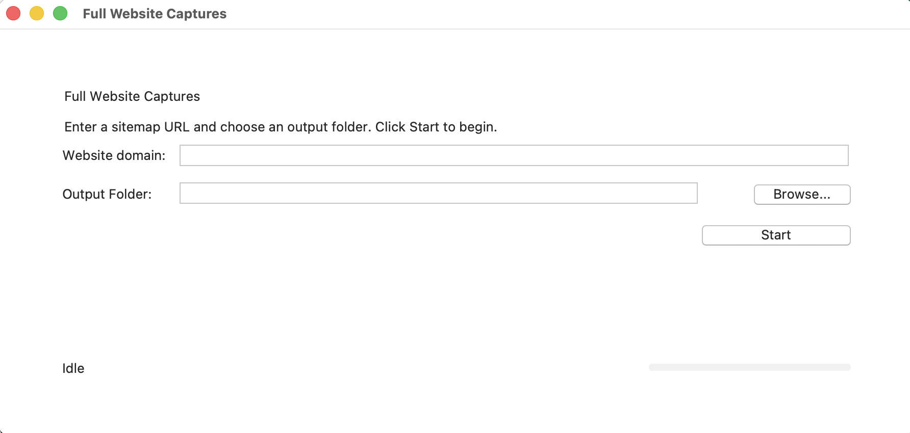

## Full Website Captures


Welcome! This GUI is a lightweight desktop front-end for the Full Website Captures tool. It lets you point the tool at a domain and choose an output folder — then takes full-page screenshots of the pages listed in the sitemap found at that domain.

Below is a screenshot of the current GUI.



This README explains how to use the GUI, what the application does under the hood, the libraries and stack it uses, common troubleshooting steps, and options for packaging into a double-clickable executable.

---

## 🔧 Quick Start — run the GUI

Recommended: use a virtual environment to avoid dependency conflicts.

```bash
python3 -m venv .venv
source .venv/bin/activate
python -m pip install --upgrade pip
# install required libraries (Playwright required if you want screenshots)
python -m pip install requests beautifulsoup4 playwright
# install Playwright browser binaries (Chromium recommended)
python -m playwright install chromium

# start the GUI (from the repository root)
python gui.py
```

Or (no venv):

```bash
python gui.py
```

The app window will open. Enter a sitemap URL (or a domain; the app will append `/sitemap.xml` if needed), select an output folder, and click Start.

---

## ▶️ What the GUI does (user workflow)

- Website domain: enter either the full sitemap URL (for example `https://example.com/sitemap.xml`) or a bare domain like `example.com` (the app will normalize this into `https://example.com/sitemap.xml`).
- Output Folder: browse to or create a folder where screenshots will be saved.
- Start: begins the process. The GUI will run the capture logic in a background thread so the UI stays responsive. A status bar and spinner indicate activity.

When finished a small pop-up will indicate how many screenshots were saved and the output folder.

---

## 🧠 Internals — how it works

- The GUI is implemented with Tkinter and ttk for a native, lightweight desktop UI (`gui.py`).
- The screenshot and sitemap logic is in `main.py` and is callable programmatically as `main.main(folder, url)`.
- Sitemap parsing: a simple XML parser extracts `<loc>` entries from a sitemap.xml and returns a de-duplicated list of page URLs.
- Screenshotting: uses Playwright (Chromium) to open each URL in a headless browser, waits for network idle and attempts to trigger lazy-loaded images by scrolling the page before taking a full-page screenshot.
- Filenames: screenshots are named by the page title (sanitized) with hyphen separators, prefixed by a zero-padded index (for example `007-Optik.png`). If a title becomes empty, a short fallback name can be used (this is easily configurable).

---

## 🧩 Libraries and stack

- Python 3 — app language.
- Tkinter (ttk) — GUI toolkit (standard in most system Pythons).
- Playwright (Python) — browser automation used for rendering pages and taking screenshots. Playwright downloads platform-specific browser binaries (Chromium, Firefox, WebKit) which must be installed with `playwright install`.
- requests — HTTP fetching for sitemap.xml.
- BeautifulSoup (bs4) — optional HTML parsing (used in some helper code paths).
- xml.etree.ElementTree — built-in XML parser used to read sitemap.xml.

---

## 📦 Packaging into a double-clickable app

Short version: use PyInstaller to produce a native executable on each target platform. See `README` in the repo root for extra resources about shipping browsers. Key points:

- Build on the target OS where possible (Windows build on Windows, macOS on macOS, etc.).
- Bundle Playwright browser artifacts or run a small first-run step that installs browsers via Playwright.
- Prefer `--onedir` distribution for ease when bundling large browser files (copy the browsers folder next to the app executable).

If you want I can add a `build.sh` that automates the virtualenv creation, Playwright browser install, and PyInstaller invocation.

---

## 🛠️ Troubleshooting

- "requests module not found" — often this means the script is running under a different Python interpreter than the one where you installed packages. Make sure your virtualenv is activated and run `which python` and `python -m pip show requests` to confirm.
- Playwright errors or missing browsers — run `python -m playwright install chromium` to fetch the Chromium binaries. If distributing, be sure Playwright's browsers are available in the packaged app or instruct users to run the install.
- Partially-loaded images in screenshots — the app attempts to auto-scroll and wait for images, but some sites use advanced lazy-loading; increasing the timeout in `main.py` or adding a retry/pause often helps.

---

## 🛠️ Developer notes & extensibility

- Progress updates: the GUI runs the capture in a background thread and shows an indeterminate spinner. For finer feedback (page X of Y), we can add a simple callback mechanism or a thread-safe queue to send per-page progress events from `main.py` to the GUI.
- Cancellation: adding a Cancel button requires exposing a stop flag to the Playwright loop and closing the browser context cleanly.
- Filename collisions: the code already appends a numeric suffix if a file exists; we can instead add a short content or URL hash for guaranteed uniqueness.

---