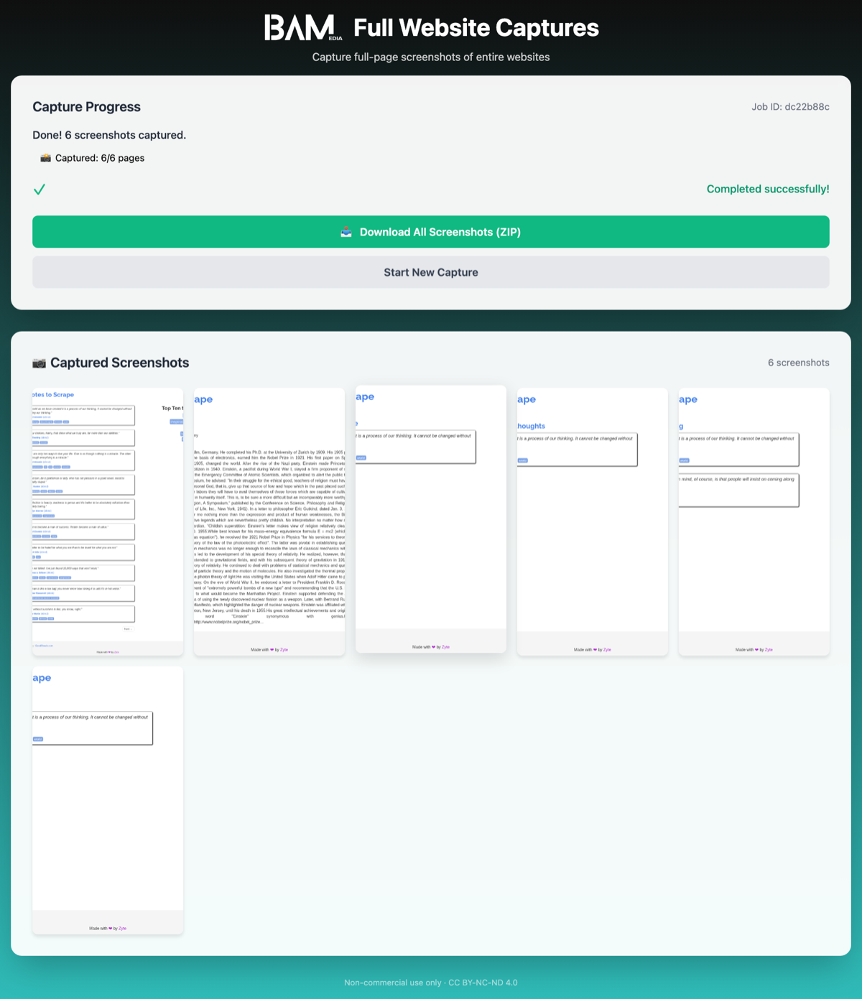
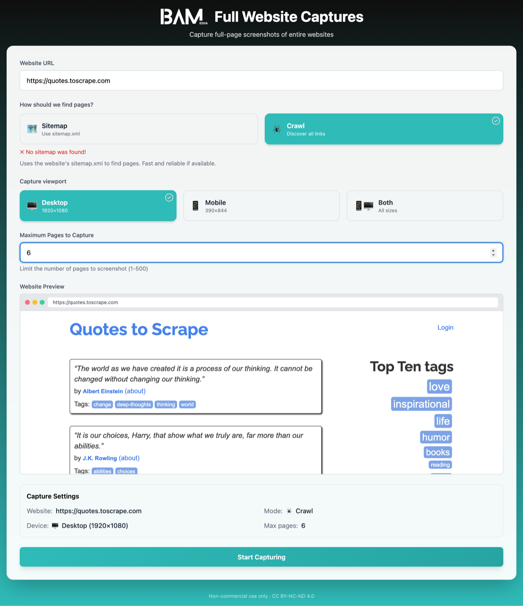

# Full Website Captures

Take full-page screenshots of every page of a website, in one go, and download them as a ZIP.

**Try it online: https://captures.smart-web-tools.com/**



## What it does

You give it a website address. It finds the pages of that site, opens each one in a real
(headless Chromium) browser, takes a full-page screenshot, and hands you all the images as a
single ZIP file. Cookie banners are dismissed automatically and lazy-loaded images are scrolled
into view first, so the screenshots look like what a visitor actually sees.

Typical uses: design reviews, before/after comparisons, client presentations, archiving a site.

## How to use it



1. **Website URL** – the site you want to capture, e.g. `https://example.com`.
2. **How to find pages**
   - **Sitemap** – reads the site's `sitemap.xml`. Fast and complete, if the site has one.
   - **Crawl** – follows the links starting from the page you entered. Works on any site.
3. **Viewport** – **Desktop** (1920×1080), **Mobile** (390×844, phone-style) or **Both**.
4. **Maximum pages** – how many pages to capture.
5. Press **Start Capturing**, watch the progress, then **Download All Screenshots (ZIP)**.

The screenshots are sent to your browser and are not stored on the server; the ZIP is built in your browser.

## Limits of the online version

The hosted version at captures.smart-web-tools.com is shared, so it has limits:

| Limit | Value |
|---|---|
| Pages per capture | up to **30** |
| Captures running at once | **1** per visitor, **2** on the whole server |
| New captures per hour | **5** per visitor (*Both* counts as two) |
| Time per capture | **10 minutes** |

Running it on your own computer (below) has none of these limits.

## Other things to know

- Crawl mode only follows links on the same site (subdomains included) and respects `robots.txt`.
- Sitemap mode reads `sitemap.xml` (sitemap indexes are supported).
- Only public websites can be captured. Addresses like `localhost` or `192.168.x.x` are refused,
  unless you start your own copy with `ALLOW_PRIVATE_URLS=1` (see below).
- Pages that need a login can't be captured.
- Very long or heavy pages can take a while; pages that fail to load are skipped.

## Run it on your own computer

### With Docker or Podman (recommended)

```bash
git clone https://github.com/Mihai-Bogdan-Robert/full-website-screenshot-capture.git
cd full-website-screenshot-capture
docker compose up --build        # or: podman compose up --build
```

Then open **http://localhost:5001**. The first build takes a few minutes (it downloads Chromium).

If the build stops with `error listing credentials ... docker-credential-desktop`, your
`~/.docker/config.json` points to a credential helper that is not installed. Remove its `credsStore`
line, or start once with an empty config: `DOCKER_CONFIG=$(mktemp -d) podman compose up --build`.

### Without a container

You need Python 3.11 or newer.

```bash
python3.11 -m venv venv
source venv/bin/activate            # Windows: venv\Scripts\activate
pip install -r requirements.txt
playwright install chromium
python app.py
```

Then open **http://localhost:5001**.

To capture a site running on your own computer (for example `http://localhost:3000`), start it
with `ALLOW_PRIVATE_URLS=1` (with Docker: uncomment that line in `docker-compose.yml`).

By default it only listens on your own computer. If you put it on the internet, add rate limiting
and a login in front of it, see [docs/TECHNICAL.md](docs/TECHNICAL.md).

## More

How it works inside (architecture, API, configuration): [docs/TECHNICAL.md](docs/TECHNICAL.md)

## License

See [LICENSE](LICENSE).
